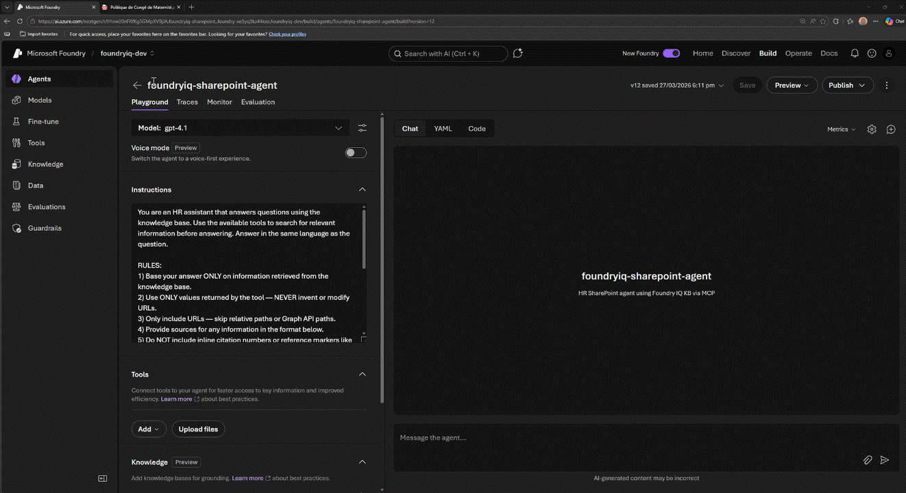

# Microsoft Foundry IQ ♡ SharePoint Demo

This repository demonstrates how to connect a Sharepoint site to a Microsoft Foundry Agent through [Foundry IQ](https://learn.microsoft.com/en-us/azure/ai-foundry/agents/concepts/what-is-foundry-iq).  
It leverages an [Indexed Sharepoint Knowledge Source](https://learn.microsoft.com/en-us/azure/search/agentic-knowledge-source-how-to-sharepoint-indexed?pivots=csharp). 



## Architecture

```
Azure AI Foundry  ──►  Azure AI Search  ──►  SharePoint Online
   (GPT-4.1)         (Knowledge Base +       (indexed via federated
                       managed identity)       credential — passwordless)
```

Note: the agent is authenticated on sharepoint through its identity; it is not leveraging OBO authentication.


## Repo Structure

```
├── ai-search/              # AI Search resource templates (envsubst placeholders)
│   ├── datasource.json     #   SharePoint data source
│   ├── index.json          #   Search index (snippet, title, page_number, doc_url, vectors)
│   ├── skillset.json       #   Skillset (chunking, embeddings, image verbalization, projections)
│   └── indexer.json        #   Indexer (daily schedule, field mappings)
├── infra/                  # Bicep IaC — all Azure resources
│   ├── main.bicep          #   Orchestrator (Foundry, Search, Monitoring, Entra app)
│   ├── foundry.bicep       #   AI Foundry account + project + model deployments
│   ├── search.bicep        #   Azure AI Search (+ RBAC for Foundry ↔ Search)
│   ├── sharepoint-app.bicep#   Entra app registration + federated credential
│   ├── graph-permissions.bicep # MS Graph API permission grants
│   └── monitoring.bicep    #   Log Analytics + App Insights
├── agent/
│   └── instructions.txt    # Agent system prompt (shared by hooks + notebook)
├── hooks/
│   ├── postdeploy.sh       #   Orchestrator — resolves env vars, calls the two scripts below
│   ├── setup-search.sh     #   AI Search: knowledge source → custom templates → indexer → KB
│   ├── setup-agent.sh      #   Foundry: MCP connection → duplicate cleanup → prompt agent
│   └── predown.sh          #   Cleans up Entra app on `azd down`
├── test/                   # Test data generators
└── azure.yaml              # azd project definition
```

## Quick Start

### Deployment pre-requisites
Required permissions:

| Requirement | Why |
|---|---|
| **Azure subscription** | Owner / Contributor to create resource groups & resources |
| **Azure Developer CLI (`azd`)** | [Install](https://learn.microsoft.com/en-us/azure/developer/azure-developer-cli/install-azd) — drives provisioning & deployment |
| **Entra ID privileges** | Ability to create App Registrations, grant **admin consent** for MS Graph `Files.Read.All` + `Sites.Read.All`, and add federated credentials |
| **SharePoint Online (M365)** | Same Entra tenant as the Azure subscription |

### Deployment

Run these commands from the repository root. If you previously ran this demo
from the root, explicitly select or reinitialize the intended `azd` environment
inside `sharepoint` before updating or deleting an existing deployment.

```bash
cd sharepoint
azd auth login
azd env set SHAREPOINT_SITE_URL https://contoso.sharepoint.com/sites/mysite
azd up
```

Note: `azd up` will prompt for the environment name and Azure region, then provision infrastructure and deploy search resources.

### Skillset & Content Understanding

The skillset uses Azure AI Search's **Content Understanding skill** to ingest and chunk SharePoint documents (PDF, DOCX, etc.) into manageable text sections with location metadata, while also extracting embedded images. Each text chunk is then vectorized with `text-embedding-3-large` for semantic search. Extracted images are passed through a **Chat Completion skill** that verbalizes them—generating natural-language descriptions of figures, diagrams, and charts—so visual content becomes searchable alongside text. The resulting chunks, vectors, and verbalized images are projected into the search index via index projections, giving the Foundry agent a rich, multimodal knowledge base over your SharePoint content.

**Index Fields**

| Field | Type | Source |
|---|---|---|
| `snippet` | `Edm.String` | Chunked text content from `ContentUnderstandingSkill` |
| `snippet_vector` | `Collection(Edm.Single)` | `text-embedding-3-large` (3072 dims) |
| `title` | `Edm.String` | `metadata_spo_item_name` (SharePoint file name) |
| `doc_url` | `Edm.String` | `metadata_spo_item_weburi` (SharePoint web URL) |
| `page_number` | `Edm.Int32` | `locationMetadata/pageNumberFrom` (PDF pages; null for DOCX) |

### Prompt examples

> how to do Professional Use of Social Media?

> what are the implications of violating the attendee policy?

> quelle est la politique de congés maternité ?

### Customisation

| Variable | Default | Description |
|---|---|---|
| `SHAREPOINT_SITE_URL` | *(required)* | SharePoint site to index |
| `SHAREPOINT_CONTAINER` | `allSiteLibraries` | `defaultSiteLibrary`, `allSiteLibraries`, or `useQuery` |
| `SHAREPOINT_QUERY` | *(empty)* | File filter when container is `useQuery` |
| `KNOWLEDGE_SOURCE_NAME` | `sharepoint-ks` | Name prefix for search resources |
| `KNOWLEDGE_BASE_NAME` | `sharepoint-kb` | Knowledge base name |
| `AGENT_NAME` | `foundryiq-sharepoint-agent` | Foundry agent name |
| `AGENT_DESCRIPTION` | `HR SharePoint agent…` | Agent description |

## References

- [What is Foundry IQ](https://learn.microsoft.com/en-us/azure/ai-foundry/agents/concepts/what-is-foundry-iq)
- [Index SharePoint data with managed identity](https://learn.microsoft.com/en-us/azure/search/search-how-to-index-sharepoint-online)
- [Create a remote SharePoint knowledge source](https://learn.microsoft.com/en-us/azure/search/agentic-knowledge-source-how-to-sharepoint-remote)
- [Create a knowledge base in Azure AI Search](https://learn.microsoft.com/en-us/azure/search/agentic-retrieval-how-to-create-knowledge-base)
- [Foundry IQ](https://learn.microsoft.com/en-us/azure/ai-foundry/agents/concepts/what-is-foundry-iq)
